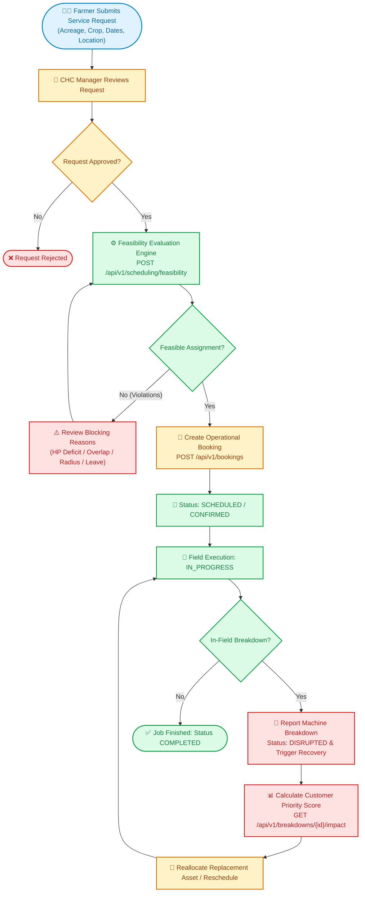
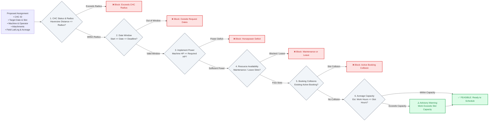
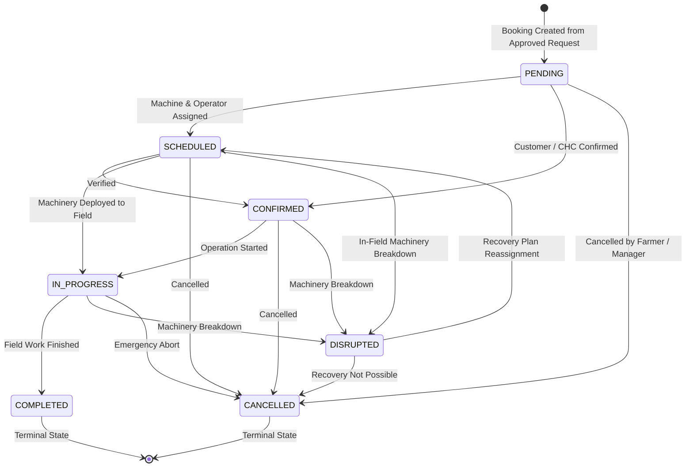

<!-- ========================================================================= -->
<!-- 🖼️ THUMBNAIL / BANNER IMAGE AREA                                          -->
<!-- ========================================================================= -->
<div align="center">
  

  <h2>🌾 KrishiNiyojak (कृषिनियोजक) — Machine-Day Composer</h2>
  <p align="center">
    <strong>Agricultural Machinery-Day Scheduling, Feasibility Engine & Breakdown-Recovery Platform for Custom Hiring Centres (CHCs)</strong>
  </p>

  <p align="center">
    <a href="#-operational-flowcharts"></a>
    <a href="#-working-features--capabilities"></a>
    <a href="#-api-endpoint-reference"></a>
    <a href="#-getting-started"></a>
    <a href="#-getting-started"></a>
    <a href="#-running-tests"></a>
  </p>
</div>

---

## 📌 Project Overview

**KrishiNiyojak** (Machine-Day Composer) is an enterprise-grade operational platform engineered for agricultural **Custom Hiring Centres (CHCs)**. It bridges the gap between regional farmer equipment demand and centralized agricultural machinery fleets (tractors, harvesters, rotavators, sprayers, seeders).

The platform:
1. **Validates Technical Compatibility:** Evaluates machine-to-implement horsepower thresholds, implements matching, and rural road transit travel times with Haversine distance.
2. **Generates Candidate Schedules:** Automates non-destructive Earliest Deadline First (EDF) scheduling with intra-schedule collision avoidance and managerial sign-off gates.
3. **Automates Breakdown Recovery:** Reacts immediately to field breakdowns, transitions machine status, blocks maintenance calendars, and calculates transparent, algorithmic customer priority scores (1–100) based on crop urgency and repair downtime.

---

## 🔄 Operational Flowcharts

### 1. End-to-End Operational Lifecycle Workflow
This flowchart demonstrates the complete operational lifecycle from farmer demand intake through scheduling feasibility evaluation, booking execution, and recovery workflows:



---

### 2. Scheduling Feasibility Engine Evaluation Flowchart
This flowchart details the multi-constraint validation rules evaluated by `app/services/feasibility.py` without persisting state:



---

### 3. Booking Lifecycle State Transitions
State machine governing operational bookings:



---

## 🚀 Working Features & Capabilities (Verified T01–T12)

The backend is fully operational and verified through automated pytest test suites (78 passing tests) and isolated database fixtures:

| Module / Domain | Status | Key Implemented Features |
|:---|:---:|:---|
| **Identity & Auth (T06)** | ✅ Verified | Argon2id password hashing, short-lived JWT access tokens (15m), opaque cryptographically random refresh tokens with SHA-256 hash storage (7d), rotation, revocation, and role-based access control (`SUPERADMIN`, `CHC_MANAGER`, `RESOURCE_OWNER`, `OPERATOR`, `FARMER`). |
| **CHC & Resources (T07)** | ✅ Verified | Full CRUD and lifecycle management for Custom Hiring Centres, Fleet Machinery (tractors, harvesters, sprayers), Certified Operators (licenses, experience), and Agricultural Implements (rotavators, seeders). |
| **Availability & Demand (T08)** | ✅ Verified | Farmer Service Request intake (GPS coordinates, crop type, acreage, requested date windows). Calendar slot tracking for machines and operators across `FULL_DAY`, `HALF_DAY_MORNING`, and `HALF_DAY_AFTERNOON` with conflict rejection. |
| **Booking Lifecycle (T09)** | ✅ Verified | Conversion of approved requests into machine-day agreements, unique booking codes, conflict validation, role-scoped queries, cancellation workflows, and state-machine transitions. |
| **Scheduling Feasibility (T10)** | ✅ Verified | Modular business engine evaluating compatibility without database side-effects (`POST /api/v1/scheduling/feasibility` & `GET /api/v1/scheduling/feasibility/{booking_id}`). Checks HP thresholds, availability slots, booking collisions, Haversine travel distance, road transit time, and operational radius limits. |
| **Schedule Generation & Approval (T11)** | ✅ Verified | Automated candidate schedule generation with Earliest Deadline First (EDF) matching and intra-schedule collision avoidance (`POST /api/v1/schedules/generate`). Review, list, non-destructive rejection, and transactional approval (`POST /api/v1/schedules/{id}/approve`) with live concurrency conflict detection (409) and audit logging. |
| **Breakdown Impact & Customer Priority (T12)** | ✅ Verified | In-field breakdown incident reporting (`POST /api/v1/breakdowns`), machine status transition (`BROKEN_DOWN`), maintenance slot blocking, dependent booking identification, status transition to `DISRUPTED`, and transparent customer priority scoring (1-100) based on deadline urgency, downtime, crop criticality, and acreage with explanatory rationales (`GET /api/v1/breakdowns/{id}/impact`). |
| **CORS & Frontend Readiness** | ✅ Verified | Native FastAPI `CORSMiddleware` configured in `app/main.py` allowing frontend connections from Vite (`5173`), React/Next.js (`3000`), and mobile development servers (`8080`). |
| **Developer Tooling** | ✅ Verified | One-command PowerShell script ([run.ps1](run.ps1)) with dependency validation, automated `.env` handling, and non-blocking verification (`.\run.ps1 -CheckOnly`). |

---

## 📂 Repository Structure

```
.
├── docs/
│   ├── assets/
│   │   └── banner.svg                  # 🖼️ README Banner / Thumbnail Graphic
│   ├── ARCHITECTURE.md                 # Detailed domain architecture documentation
│   ├── IMPLEMENTATION_CHECKLIST.md     # Production milestone verification checklist
│   └── README.md
├── app/
│   ├── main.py                         # FastAPI app entrypoint, CORS & global exception handlers
│   ├── api/
│   │   ├── deps.py                     # Authentication & granular RBAC dependencies
│   │   └── v1/
│   │       ├── auth.py                 # Registration, login, token refresh, logout
│   │       ├── chcs.py                 # CHC hub management endpoints
│   │       ├── machines.py             # Machinery fleet inventory endpoints
│   │       ├── operators.py            # Certified operator endpoints
│   │       ├── attachments.py          # Implement & tool endpoints
│   │       ├── service_requests.py     # Farmer demand intake endpoints
│   │       ├── availability.py         # Machine & operator calendar slots
│   │       ├── bookings.py             # Operational booking lifecycle endpoints
│   │       ├── scheduling.py           # Feasibility checking endpoints
│   │       ├── schedules.py            # Schedule generation, review, approval & rejection
│   │       └── breakdowns.py           # Breakdown reporting & impact analysis endpoints
│   ├── core/
│   │   ├── config.py                   # Pydantic Settings, CORS origins & scoring weights
│   │   └── security.py                 # Argon2id hashing & JWT token issuance
│   ├── db/
│   │   ├── base.py                     # SQLAlchemy 2.x declarative Base
│   │   └── session.py                  # Database engine & sessionmaker
│   ├── models/                         # 21 Relational SQLAlchemy models
│   │   ├── chc.py                      # CHCs, CHCMemberships
│   │   ├── identity.py                 # Users, Roles, UserRoles
│   │   ├── resource.py                 # ResourceOwners, Machines, Operators, Attachments
│   │   ├── booking.py                  # ServiceRequests, Bookings, BookingAttachments
│   │   ├── availability.py             # MachineAvailability, OperatorAvailability
│   │   ├── recovery.py                 # Breakdowns, RecoveryPlans, Priorities
│   │   └── supporting.py               # RefreshTokens, AuditLogs, Notifications
│   ├── schemas/                        # Pydantic v2 schemas for all domains
│   │   ├── auth.py                     # Authentication & token schemas
│   │   ├── chc.py                      # CHC schemas
│   │   ├── resource.py                 # Machinery, operators & implements schemas
│   │   ├── service_request.py          # Demand intake schemas
│   │   ├── availability.py             # Shift & slot schemas
│   │   ├── booking.py                  # Booking state machine schemas
│   │   ├── scheduling.py               # Feasibility and schedule proposal models
│   │   └── recovery.py                 # Breakdown reporting and impact analysis models
│   └── services/
│       ├── breakdown.py                # Breakdown reporting & customer priority scoring
│       ├── feasibility.py              # Modular scheduling rules & travel estimation
│       ├── scheduler.py                # Candidate schedule generation & approval engine
│       └── schedule_store.py           # Thread-safe in-memory schedule proposal registry
├── tests/
│   ├── test_auth.py                    # 12 Authentication & RBAC unit tests
│   ├── test_models.py                  # 5 Schema, metadata & relationship tests
│   ├── test_health.py                  # 3 Health check & OpenAPI registration tests
│   ├── test_resources.py               # 14 CHC, machine, operator & attachment tests
│   ├── test_service_requests_and_availability.py # 8 Demand intake & slot tests
│   ├── test_bookings.py                # 8 Booking state machine & lifecycle tests
│   ├── test_scheduling_feasibility.py  # 13 Feasibility checker & travel tests
│   ├── test_scheduling_generation.py   # 8 Schedule generation & approval tests
│   └── test_breakdown_impact.py        # 7 Breakdown reporting & customer priority tests
├── alembic/                            # Alembic database migrations
├── run.ps1                             # Automated PowerShell startup & test script
├── pyproject.toml                      # Project metadata & Python dependencies
└── .env.example                        # Safe configuration template
```

---

## ⚡ Getting Started

### Prerequisites

- **Python 3.12 or newer** (tested on Python 3.14)
- **PowerShell** (Windows) or **Bash** (Linux/macOS)
- Optional: PostgreSQL / Supabase account for live database persistence

---

### One-Command Startup (Windows PowerShell)

From the project root:

```powershell
.\run.ps1
```

The script automatically prepares `.venv`, installs/verifies all dependencies, configures `.env`, and launches the FastAPI application at **[http://127.0.0.1:8000](http://127.0.0.1:8000)**.

To run non-blocking pre-flight checks:
```powershell
.\run.ps1 -CheckOnly
```

---

### Interactive Documentation & Testing Endpoints

Once the application is running, open:
- **Interactive Swagger UI:** [http://127.0.0.1:8000/docs](http://127.0.0.1:8000/docs)
- **ReDoc API Reference:** [http://127.0.0.1:8000/redoc](http://127.0.0.1:8000/redoc)
- **Health Check:** [http://127.0.0.1:8000/health](http://127.0.0.1:8000/health)

---

### Running Tests

Execute the automated test suite (78 tests):

```powershell
# Run all independent unit tests
pytest tests/test_auth.py tests/test_models.py tests/test_health.py tests/test_resources.py tests/test_service_requests_and_availability.py tests/test_bookings.py tests/test_scheduling_feasibility.py tests/test_scheduling_generation.py tests/test_breakdown_impact.py -v

# Run code style & lint checks with Ruff
ruff check .
ruff format --check .
```

---

## 💻 Frontend Integration Guide

1. **API Base URL:** Connect your HTTP client (Axios, Fetch, TanStack Query) to:
   ```
   http://127.0.0.1:8000/api/v1
   ```
2. **CORS:** Pre-configured in `app/main.py` for `http://localhost:3000`, `http://localhost:5173`, and `http://localhost:8080`.
3. **Authentication Header:** Pass the JWT token on every protected route:
   ```
   Authorization: Bearer <access_token>
   ```
4. **Feasibility Dry-Run:** In the booking UI, call `POST /api/v1/scheduling/feasibility` before committing a booking to warn the user about horsepower deficits, route distance, or schedule conflicts.
