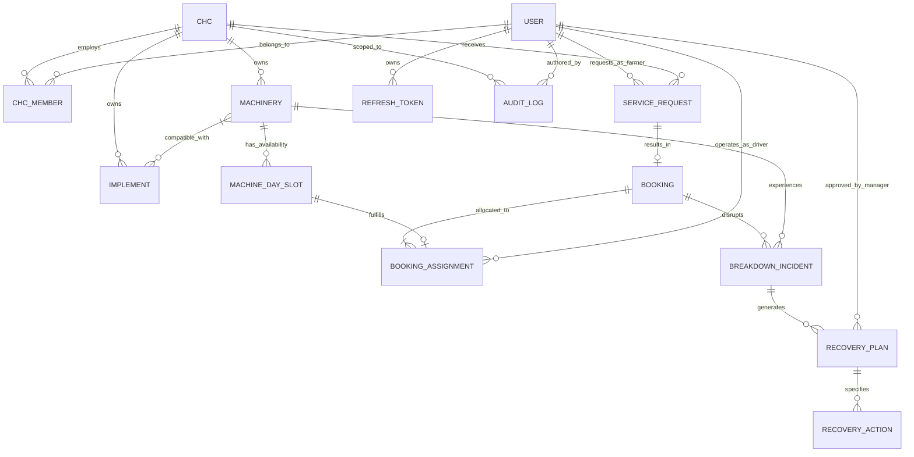

# Machine-Day Composer — System Architecture Specification

## 1. Executive Summary & Architectural Overview

**Machine-Day Composer** is an agricultural machinery scheduling and breakdown-recovery platform engineered for **Custom Hiring Centres (CHCs)**. CHCs manage fleets of shared farm machinery (tractors, combine harvesters, laser levelers, balers, seed drills) and qualified operators to deliver mechanization services to smallholder and commercial farmers.

The central operational currency of the system is the **Machine-Day**: a discrete unit of operational machinery capacity deployed across regional farmer service requests. Because agricultural operations are strictly time-sensitive (bound by sowing/harvesting windows, monsoons, and soil moisture conditions), machinery breakdowns present catastrophic risks to crop yield. Machine-Day Composer provides optimized scheduling and dynamic breakdown-recovery workflows.

### Architectural Pattern: Modular Monolith
The platform adopts a **Modular Monolith** architecture:
- **Unified Deployment & Runtime:** Simple operational footprint via Python and FastAPI.
- **Strict Domain Boundaries:** Modules are decoupled internally with clear interfaces, domain-level isolation, and dependency rules, enabling future extraction into independent microservices if organizational or scaling requirements demand it.
- **Shared Persistence with Logical Scoping:** Single PostgreSQL instance with strict multi-tenancy enforced at the CHC (tenant) level via tenant identifiers and row-level access control.

---

## 2. Technology Stack

| Layer | Component | Technology | Rationale |
| :--- | :--- | :--- | :--- |
| **Backend Framework** | API Gateway & App Engine | **Python 3.12+ / FastAPI** | High-performance asynchronous execution, native OpenAPI generation, automatic Pydantic validation. |
| **Data Validation** | Schema & Settings | **Pydantic v2 / Pydantic-Settings** | Strict type enforcement, zero-cost parsing, unified configuration management. |
| **Database & ORM** | Relational Database & ORM | **PostgreSQL 16+ / SQLAlchemy 2.x** | ACID compliance, spatial/geographical queries (PostGIS-ready), typed mapped models. |
| **Migrations** | Schema Evolution | **Alembic** | Version-controlled, reproducible, reversible schema migrations. |
| **Authentication** | Cryptography & Sessions | **Argon2id & JWT (Access + Refresh)** | Industry-standard password hashing resilience, stateless token verification, rotatable refresh tokens. |
| **Testing** | Test Runner & HTTP Client | **pytest / pytest-asyncio / HTTPX** | Pytest fixtures, isolated test transactions, asynchronous endpoint validation. |
| **Local Infrastructure** | Container Orchestration | **Docker Compose** | Reproducible multi-service developer environment (Backend, PostgreSQL, Redis/Worker). |
| **Mobile Client (Future)**| Cross-Platform Client | **React Native / Expo / TypeScript** | Unified codebase for Android/iOS field app used by operators, technicians, and CHC managers. |

---

## 3. Module Boundaries & Responsibilities

The codebase is organized into bounded modules under `app/modules/` (or `app/domain/`), each encapsulating its schemas, service layer, repository layer, and domain events:

```
app/
├── core/                   # Global configuration, security primitives, database sessions, error handlers
├── modules/
│   ├── auth/               # Password hashing, JWT token issuance, refresh token rotation, session invalidation
│   ├── users/              # User profiles, system roles, CHC staff assignments
│   ├── chcs/               # Custom Hiring Centre hubs, operational zones, equipment fleets
│   ├── resources/          # Machinery, implements, operators, maintenance logs
│   ├── service_requests/   # Farmer demand intake, acreage, target crop, requested dates
│   ├── bookings/           # Confirmed operational commitments resulting from approved requests
│   ├── availability/       # Machine-day calendar, capacity slots, operational blackouts
│   ├── scheduling/         # Allocation optimizer, constraint satisfaction, route clustering
│   ├── breakdown_recovery/ # Incident reporting, impact analysis, recovery plan generation & dispatch
│   ├── notifications/      # Dispatch alerts (SMS, push, email) for schedule updates & breakdowns
│   └── audit_logs/         # Immutable append-only audit trail for operational mutations
└── main.py                 # Application bootstrap, router inclusion, lifespan events
```

### Module Descriptions & Invariants

1. **`auth`**:
   - Manages user credentials using **Argon2id**.
   - Issues short-lived JWT access tokens (e.g., 15 minutes) and long-lived refresh tokens (e.g., 7 days) stored with cryptographic hash in the database.
   - Enforces token revocation (refresh token rotation with single-use detection).
2. **`users`**:
   - Manages user identity (`Farmer`, `Operator`, `CHC Manager`, `Technician`, `System Admin`).
   - Supports multi-tenant association: A user can be an operator or manager in one or more CHCs.
3. **`chcs`**:
   - Represents the physical hub (depot), geographic operating polygon/radius, contact info, and operational settings (e.g., default working hours per machine-day).
4. **`resources`**:
   - Manages machinery assets (tractors, harvesters), implement attachments (rotavator, laser leveler), and certified operators.
   - Tracks machinery capabilities (horsepower, hitch type, PTO speed) and compatibility constraints with implements and crops.
5. **`service_requests`**:
   - Captures agricultural work orders submitted by or on behalf of farmers: location (coordinates), field size (acres/hectares), crop, target operation, preferred time window.
6. **`bookings`**:
   - The executed agreement binding a service request to a specific CHC, establishing pricing, billing status, and operational state.
7. **`availability`**:
   - Manages the discrete **Machine-Day** and **Machine-Half-Day** capacity units.
   - Prevents double-booking and registers scheduled maintenance or operator leave.
8. **`scheduling`**:
   - Solves the assignment of machine-days to pending bookings.
   - Balances hard constraints (equipment capability, operator qualification, geographic proximity) and soft constraints (deadhead travel time, customer priority, seasonal deadlines).
9. **`breakdown_recovery`**:
   - Dedicated subsystem for handling in-field operational failures.
   - Receives breakdown reports from operators/technicians.
   - Computes downstream impact on scheduled bookings.
   - Generates candidate recovery strategies:
     - **Option A (Direct Replacement):** Swap with an idle compatible machine from the same CHC.
     - **Option B (Sister-CHC Mutual Aid):** Cross-lease from an adjacent CHC within travel radius.
     - **Option C (Time-Shift / Reschedule):** Push non-critical jobs into buffer slots.
     - **Option D (Emergency Subcontract / Cancellation):** Release job or contract external vetted provider.
10. **`notifications`**:
    - Dispatches alerts across channels (SMS/Push notifications) to farmers (arrival notice, delay), operators (job dispatch, reroute), and managers (breakdown alerts).
11. **`audit_logs`**:
    - Append-only recording of sensitive operations: booking cancellations, manual schedule overrides, breakdown incident logging, and recovery plan approvals.

---

## 4. Entity Model & Relationships



### Core Entities & Key Fields

- **`CHC`**: `id`, `name`, `code`, `latitude`, `longitude`, `operating_radius_km`, `status`, `created_at`.
- **`User`**: `id`, `email`, `phone_number`, `hashed_password`, `full_name`, `system_role`, `is_active`, `created_at`.
- **`CHCMember`**: `id`, `chc_id`, `user_id`, `chc_role` (`MANAGER`, `OPERATOR`, `TECHNICIAN`), `is_active`.
- **`Machinery`**: `id`, `chc_id`, `registration_number`, `model`, `category` (`TRACTOR`, `HARVESTER`, `SPRAYER`), `horsepower`, `status` (`AVAILABLE`, `DEPLOYED`, `MAINTENANCE`, `BROKEN_DOWN`), `current_lat`, `current_lng`.
- **`Implement`**: `id`, `chc_id`, `name`, `category` (`PLOW`, `ROTAVATOR`, `SEEDER`, `BALER`), `required_hp_min`, `status`.
- **`ServiceRequest`**: `id`, `chc_id`, `farmer_id`, `field_latitude`, `field_longitude`, `acreage`, `operation_type`, `requested_start_date`, `requested_end_date`, `status` (`DRAFT`, `SUBMITTED`, `REJECTED`, `APPROVED`).
- **`Booking`**: `id`, `service_request_id`, `chc_id`, `booking_code`, `status` (`PENDING`, `SCHEDULED`, `IN_PROGRESS`, `COMPLETED`, `CANCELLED`, `DISRUPTED`), `total_estimated_hours`, `created_at`.
- **`MachineDaySlot`**: `id`, `machinery_id`, `slot_date`, `slot_type` (`FULL_DAY`, `HALF_DAY_MORNING`, `HALF_DAY_AFTERNOON`), `status` (`FREE`, `HELD`, `BOOKED`, `BLOCKED_MAINTENANCE`).
- **`BookingAssignment`**: `id`, `booking_id`, `machinery_id`, `implement_id`, `operator_id`, `machine_day_slot_id`, `scheduled_date`, `status`.
- **`BreakdownIncident`**: `id`, `machinery_id`, `booking_id`, `operator_id`, `reported_at`, `failure_type` (`ENGINE`, `HYDRAULIC`, `IMPLEMENT`, `ELECTRICAL`, `PUNCTURE`), `severity` (`LOW`, `CRITICAL`), `field_lat`, `field_lng`, `status` (`REPORTED`, `UNDER_RECOVERY`, `RESOLVED`).
- **`RecoveryPlan`**: `id`, `breakdown_incident_id`, `strategy` (`REPLACE_MACHINE`, `TIME_SHIFT`, `SUBCONTRACT`, `CANCEL`), `status` (`PROPOSED`, `ACCEPTED`, `EXECUTED`), `created_at`, `approved_by`.
- **`AuditLog`**: `id`, `chc_id`, `user_id`, `action`, `entity_type`, `entity_id`, `payload_before`, `payload_after`, `timestamp`.

---

## 5. Lifecycles, Constraints & Workflows

### 5.1 Booking Lifecycle

```
[DRAFT]
   │
   ▼ (Farmer submits)
[SUBMITTED] ─────────────► [REJECTED by Manager]
   │
   ▼ (Manager Approves / Auto-Approve rule)
[APPROVED]
   │
   ▼ (Scheduling Engine binds Machine-Day & Operator)
[SCHEDULED]
   │
   ▼ (Operator starts job in field)
[IN_PROGRESS]
   ├───► [COMPLETED] (Work verified & signed off)
   │
   ▼ (Machinery failure logged)
[DISRUPTED] ─────────────► [RECOVERED & RE-SCHEDULED] ──► [IN_PROGRESS]
   │
   ▼ (If recovery impossible)
[CANCELLED / REFUNDED]
```

### 5.2 Scheduling Constraints

1. **Hard Constraints (Must Never Be Violated):**
   - **Capability Match:** The assigned tractor must satisfy the horsepower and hitch requirements of the attached implement.
   - **Operator Competency:** The assigned operator must hold valid certification/experience for the machine type.
   - **Temporal Exclusivity:** No machine or operator may be assigned to more than one field for the same machine-day slot.
   - **Maintenance Lock:** Machines marked as `MAINTENANCE` or `BROKEN_DOWN` are excluded from slot generation.
   - **CHC Jurisdiction:** Service requests must fall within the defined `operating_radius_km` of the servicing CHC (unless cross-CHC mutual aid is explicitly enabled).

2. **Soft Constraints (Optimization Targets):**
   - **Deadhead Minimization:** Group consecutive field bookings within proximate geographic clusters to reduce tractor transit fuel and road wear.
   - **Agronomic Urgency:** Prioritize crops approaching terminal harvest or sowing weather deadlines.
   - **Fleet Wear Balancing:** Distribute engine operating hours evenly across equivalent machines in the CHC depot.

### 5.3 Manager Approval Workflow
- When a `ServiceRequest` is received, the system validates capacity and preliminary route feasibility.
- If capacity is constrained, the request is flagged for **Manager Review**.
- The CHC Manager reviews acreage, field topography, requested machinery, and route implications before issuing an `APPROVED` or `REJECTED` decision.
- Optional configuration allows **Auto-Approval** for high-reputation farmers within a 10 km radius during non-peak windows.

### 5.4 Breakdown-Recovery Workflow

```mermaid
sequenceDiagram
    autonumber
    actor Operator as Field Operator
    participant App as Mobile App / API
    participant BR as Breakdown Recovery Module
    participant Sched as Scheduling & Availability
    actor Mgr as CHC Manager
    actor Farmer as Farmer

    Operator->>App: Report Breakdown (Failure Type, Photo, Field Location)
    App->>BR: POST /breakdown-incidents
    BR->>Sched: Mark Machine as BROKEN_DOWN & Current Booking as DISRUPTED
    BR->>BR: Identify affected downstream bookings in time window
    BR->>BR: Generate candidate Recovery Plans (Replace, Shift, Subcontract)
    BR->>Mgr: Notify Manager with Ranked Recovery Options
    Mgr->>App: Review & Select Recovery Plan (e.g. Dispatch Backup Tractor)
    App->>BR: POST /recovery-plans/{id}/execute
    BR->>Sched: Reallocate Machine-Day slot & assign backup machine
    BR->>Farmer: Send SMS/Push: "Replacement tractor dispatched; ETA +45m"
    BR->>Operator: Route backup operator/tractor to coordinates
```

---

## 6. API Conventions, Authorization & Security

### 6.1 API Conventions
- **Prefix:** `/api/v1`
- **Resource Naming:** Plural kebab-case or snake_case REST resources (`/api/v1/service-requests`, `/api/v1/breakdown-incidents`).
- **Standardized Response Envelope:**
  ```json
  {
    "success": true,
    "data": { ... },
    "error": null
  }
  ```
- **Standardized Error Envelope:**
  ```json
  {
    "success": false,
    "data": null,
    "error": {
      "code": "RESOURCE_UNAVAILABLE",
      "message": "No compatible tractor available for the selected machine-day.",
      "details": []
    }
  }
  ```
- **Pagination:** Query parameters `page` and `page_size` or cursor-based tokens (`limit`, `cursor`).

### 6.2 Authorization & Multi-Tenancy Rules
- **Roles:**
  - `SUPERADMIN`: Platform-wide governance, global metrics, CHC onboarding.
  - `CHC_MANAGER`: Full management of assigned CHC fleet, operators, bookings, and breakdown overrides.
  - `OPERATOR`: Access limited to assigned daily work orders, route maps, and breakdown reporting.
  - `FARMER`: Access limited to self-owned service requests, booking status, and receipts.
- **Tenant Isolation:** Every operational table references `chc_id`. Queries execute with mandatory tenant filtering derived from the authenticated user's active CHC session context.

---

## 7. Testing, Configuration & Migration Principles

### 7.1 Testing Strategy
- **Unit Tests:** Fast, isolated tests for scheduling algorithms, constraint evaluators, recovery plan generation, and Pydantic validation schemas.
- **Integration Tests:** Execute against isolated PostgreSQL test database transactions (rolling back after each test) to verify SQLAlchemy queries, constraints, and cascade behaviors.
- **E2E / API Tests:** TestClient invocations testing the entire HTTP cycle, JWT verification, and endpoint error handling.
- **Target:** Maintain high test coverage with automated execution in CI.

### 7.2 Configuration Principles
- Adhere strictly to **Twelve-Factor App** methodology.
- Configurations declared in `app/core/config.py` using `pydantic-settings.BaseSettings`.
- Zero hardcoded credentials or environment assumptions. Secrets injected strictly via environment variables or secret vaults.

### 7.3 Database & Migration Principles
- **Alembic Exclusivity:** All database DDL changes must be performed through Alembic migration scripts.
- **Reversibility:** Every migration must implement both `upgrade()` and `downgrade()` methods.
- **Zero-Downtime Safe:** Disallow destructive schema modifications (e.g., immediate column drops) without multi-stage deprecation migrations.

---

## 8. Unresolved Business Decisions & Explicit Assumptions

The following decisions require business stakeholder resolution before implementing the concrete database schema and business logic:

1. **Slot Granularity (Full-Day vs. Half-Day vs. Hourly):**
   - *Current Assumption:* Default allocation is based on **Half-Day (Morning / Afternoon)** and **Full-Day** machine-day blocks, as field transit makes micro-hourly slots unpredictable.
   - *Open Decision:* Does the platform require fine-grained hourly dispatching for small acreage plots (< 1 acre)?
2. **Cross-CHC Mutual Aid Agreements:**
   - *Current Assumption:* Bookings are strictly fulfilled by the hosting CHC.
   - *Open Decision:* Can a CHC Manager legally or contractually auto-delegate or sub-lease a recovery job to an adjacent independently-owned CHC?
3. **Payment & Billing Gateways:**
   - *Current Assumption:* Platform tracks booking costs and payment status flags (`PENDING`, `PAID`, `SUBSIDIZED`), but actual payment gateway integration is deferred to later phases.
   - *Open Decision:* Will farmers pay directly via mobile money (e.g., UPI, M-Pesa) inside the app, or is cash collected on-field by the operator?
4. **Offline Capability for Field Operators:**
   - *Current Assumption:* Operators submit breakdown reports and job progress when cellular connectivity is present.
   - *Open Decision:* Is an offline-first SQLite synchronization engine required on the React Native mobile client for remote rural areas without network coverage?
